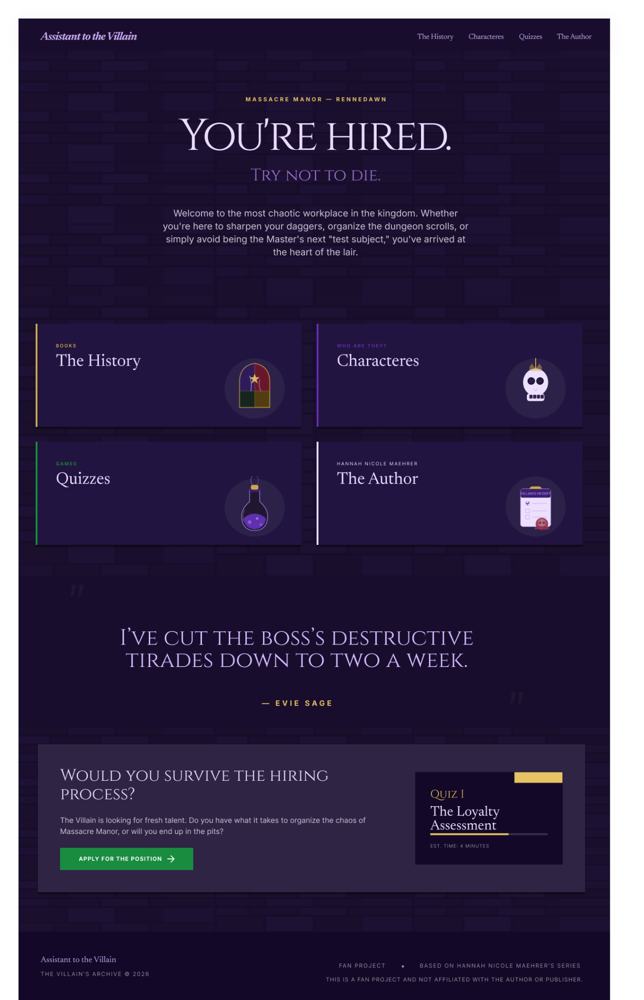

<div align="center">

# Assistant to the Villain
### Welcome to Massacre Manor

**An interactive, mobile-first fan experience inspired by Hannah Nicole Maehrer's fantasy series.**

Designed as an immersive digital world where storytelling, interface design, and playful interactions meet.

**[Enter the Realm — Live on Vercel](https://assistant-to-the-villain-fan-site.vercel.app/)** · [GitHub Pages](https://tricialinewberg.github.io/assistant-to-the-villain-fan-site/) · [Explore the Design System](reference/boards/design-system.png)

</div>

---

## The concept

What if entering the Villain's manor felt like applying for a very questionable job?

This independent UX/UI and web-design project brings the atmosphere of *Assistant to the Villain* into an interactive website. It combines a dark-fantasy visual identity with character dossiers, a book collection, whimsical quiz invitations, and a fictional hiring assessment.

The experience is based on **seven original interface designs**, supported by a dedicated **design system** and **visual-elements library**. The website was then implemented as a responsive React application—not as a set of static screenshots.

### Original interface design



*Original desktop homepage design reference. The [live website](https://assistant-to-the-villain-fan-site.vercel.app/) is fully implemented and interactive.*

## Explore the manor

| Experience | What you'll find |
| --- | --- |
| **Welcome to Massacre Manor** | A cinematic entry scene and an invitation to enter the realm. |
| **The History** | The series' books, illustrated cover presentations, links to Amazon Brazil, and information about the author. |
| **Meet the Staff** | Character dossiers featuring Evie Sage, Trystan Maverine, Becky Erring, and Kingsley, presented in a responsive, keyboard-accessible carousel. |
| **Discover Your Fate** | Four illustrated quiz invitations inspired by the world of Rennedawn. |
| **The Hiring Assessment** | An 18-question interface with answer selection, progress, previous/next navigation, saved answers, and a review screen. |

> **Quiz status:** The interface and state management are implemented, but only question **Q07** has approved question-and-answer copy. The other questions, final scoring, and results are intentionally unavailable until their content is finalized. The other three quiz concepts are marked *Coming Soon*.

## Visual identity & motion

The visual system takes inspiration from the fictional workplace at Massacre Manor:

- **Color palette:** onyx, deep plum, Rennedawn purple, lilac, ancient gold, crimson, and frog-green accents.
- **Typography:** Cinzel for the theatrical display language and Inter for readable interface text.
- **Atmosphere:** castle-stone textures, a dark forest, paper notes, illustrated icons, and framed character artwork.
- **Trystan-inspired shadows:** gray-purple smoke-like effects that respond to pointer movement and mobile gestures.
- **Kingsley's cameos:** the crowned frog occasionally appears with a dismissible note.
- **Interactive feedback:** golden and shadow-like bursts on clicks and taps, card transitions, and animated navigation details.

The motion system uses lightweight browser animation APIs. Decorative effects are designed not to intercept scrolling, taps, or keyboard navigation, and respect the user's reduced-motion preference.

## UX & implementation principles

- **Mobile-first:** layouts adapt from narrow screens to larger desktop views.
- **Accessibility-conscious:** semantic structure, visible focus states, keyboard controls, touch interactions, and reduced-motion handling.
- **Design fidelity:** implemented from the original screens and UI specifications, rather than replacing them with a generic template.
- **Real navigation:** React Router routes for the manor, books, characters, quizzes, and assessment.
- **Honest UI states:** incomplete quizzes are clearly identified instead of displaying fabricated outcomes.
- **No backend required:** the website is a static client-side application.

Automated checks cover responsive overflow, navigation, quiz state, keyboard/touch interactions, and WCAG-oriented accessibility audits. These tests support the implementation but do not replace testing with real people and devices.

## Built with

| Area | Technologies |
| --- | --- |
| **Interface** | React 19, TypeScript, React Router |
| **Tooling** | Vite 8 |
| **Styling & motion** | Custom CSS, Web Animations API, responsive layouts |
| **Typography** | Cinzel and Inter via Fontsource |
| **Testing** | Vitest, Playwright, axe-core |
| **CI & hosting** | GitHub Actions, Vercel, GitHub Pages |

## Run locally

Requires **Node.js 24** (minimum supported by the project: 22.18).

```bash
git clone https://github.com/tricialinewberg/assistant-to-the-villain-fan-site.git
cd assistant-to-the-villain-fan-site
npm ci
npm run dev
```

Open **http://127.0.0.1:5173/**.

For validation:

```bash
npm run typecheck
npm test
npm run build
npx playwright install chromium
npm run test:e2e
```

On Windows, the Playwright configuration uses an installed Microsoft Edge; on other platforms it uses Chromium.

## Project documentation

The repository preserves the original design references and implementation notes:

- [Original interface screens](reference/screens/)
- [Design System — Rennedawn UI Kit](reference/boards/design-system.png)
- [Visual Elements, Textures & UI Copy](reference/boards/visual-elements.png)
- [Screens and user flows](docs/SCREENS_AND_FLOWS.md)
- [Motion design & accessibility checks](docs/MOTION_AND_QA.md)
- [Asset inventory and limitations](docs/ASSET_LEDGER.md)

The visual references are source material for the implementation; they are not used as static page backgrounds. Some illustrations and cover images remain provisional crops pending suitable high-resolution, appropriately sourced assets.

## Live versions

**Primary:** [assistant-to-the-villain-fan-site.vercel.app](https://assistant-to-the-villain-fan-site.vercel.app/)

**Alternative:** [GitHub Pages](https://tricialinewberg.github.io/assistant-to-the-villain-fan-site/)

Vercel uses the site's root path. GitHub Pages builds with the repository-specific Vite base path through GitHub Actions.

## Creator & disclaimer

**Original UX/UI design, design system, concept, and art direction:** [Trícia Linewberg](https://tricia-linewberg-portfolio.vercel.app/)

[Portfolio](https://tricia-linewberg-portfolio.vercel.app/) · [LinkedIn](https://www.linkedin.com/in/tricia-linewberg/) · [GitHub](https://github.com/tricialinewberg)

This is an **unofficial, non-commercial fan project** inspired by Hannah Nicole Maehrer's *Assistant to the Villain* series. It is not affiliated with or endorsed by the author, publisher, or other rights holders. Book covers, character depictions, and author photography belong to their respective rights holders.

---

<div align="center">

*Discretion is essential. Excellent benefits.*

</div>
